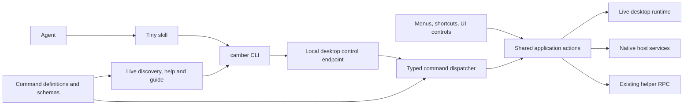

# Camber desktop CLI implementation plan

Build `poolside` as a supported, self-describing client of the running desktop app. Every user-facing desktop operation should have a discoverable CLI equivalent, execute through the same application logic, and expose enough state for an agent to verify the result. Ship a tiny skill that loads its instructions from the installed CLI.

Milestone 1 is implemented in this branch; see the [current CLI guide](camber-cli.md)
for its supported commands and installation. The complete catalog below is the
target interface for subsequent milestones, not a claim of current desktop parity.

**Milestone 1 — conversation orchestration**

Deliver a usable CLI that lets any desktop conversation delegate work to ordinary child conversations, configure the agent before its first prompt, and coordinate work across shared or isolated worktrees. Child conversations remain visible and usable in the desktop. The rest of the command catalog is subsequent work.

Milestone 1 includes:

- A native `poolside` executable and a production local desktop endpoint, with instance discovery, identity validation, explicit targeting, status, action discovery, and a tiny skill that delegates to `camber skill show`.
- Agent listing and configuration discovery through `agents config options AGENT`, plus effective conversation configuration through `chat config list CHAT`. Expose the agent's actual option IDs, allowed values, categories, and current values. Session-dependent options must be discovered through an initialized session rather than guessed.
- `chat config set` for a single value or a configuration object. Validate the requested options and values, report unsupported options, and return effective values. Reject changes while a turn is active unless the agent explicitly supports them.
- `chat spawn PARENT` with explicit task text, optional agent/model/effort/configuration overrides, and an existing or newly created worktree. Ordering is create session, discover options, validate and apply configuration, verify effective values, then submit the prompt. A configuration failure must not start the task.
- Persistent parent/root conversation relationships, child listing, inspection, idempotent spawning, and resource ownership. Same-agent children inherit compatible parent settings unless overridden; changing agents starts from the destination agent's defaults plus explicit overrides.
- Sending follow-up prompts, steering and stopping a named turn, inspecting output, cursor-based immediate/long polling, and live output streaming. Reading must work without focusing the child. UI-started turns must also be observable.
- Project/worktree discovery and worktree creation/removal through the existing application services. A new worktree's setup must finish before prompting a child; failed setup must be visible. Shared worktrees are an explicit choice. Cleanup never silently deletes unrelated or still-active work.
- Per-conversation origin context, including desktop instance and conversation identity, so a child can itself delegate without relying on the user's current UI focus.
- Structured pending-interaction and terminal outcomes. Ending a response is distinct from completing the assigned task. Readers disconnect independently of generation, and existing approval policy remains in force.

The first release does not need general window/layout control, terminal automation, the full settings catalog, or automatic Git integration. A parent can inspect the child's worktree and use normal Git tooling to review and integrate changes.

Milestone acceptance is one agent successfully discovering configuration options, spawning two children with selected configurations in different worktrees, observing them through streaming and polling, steering one, collecting both outcomes, and seeing the same children and state in the desktop. Include failed configuration, duplicate spawn, interrupted reader, waiting-for-input, and worktree setup failure cases.

**Follow-up — sandbox access (investigated 2026-10-20; not implemented)**

Agents running inside a Codex shell sandbox can read the desktop discovery
record but receive `EPERM` when connecting to its Unix socket. Discovery currently
discards handshake failures, so the CLI reports an unavailable instance. This is
not a missing CLI installation or an unreadable discovery directory.

The intended solution is an explicit grant for the current desktop's canonical
socket path, scoped to the agent session and preserving all other permissions.
Do not grant the socket directory or persist changes to the user's Codex config.

Local macOS probes against Codex **0.160.1** and codex-acp **2.2.2** found:

| Probe | Result |
| --- | --- |
| Normal sandbox, network access disabled | Desktop socket connection denied |
| `codex sandbox --allow-unix-socket CANONICAL_SOCKET_PATH`, network access disabled | `camber status --json` succeeds |
| `features.network_proxy` with an exact `unix_sockets` allow entry | Accepted, but connection still denied |
| Same feature with `enabled=true`, through app-server `command/exec` and a real ephemeral Codex turn | Connection still denied |
| Named permissions profile extending `:workspace`, with networking disabled and an exact socket allow entry, in a real ephemeral turn | Connection still denied |

The real-turn probes used `approval_policy="never"` to prevent an elevated retry
from disguising a failed sandbox grant. The explicit sandbox flag is a diagnostic
positive control; it is not proof that ordinary agent commands inherit the grant.
The installed adapter accepts `CODEX_CONFIG` for thread creation and resumption,
but no working config-only grant was demonstrated. No automatic grant is shipped.

Before implementing, verify a supported Codex/adapter path that carries the
exact socket grant into normal shell execution with networking disabled.
Canonicalize `/tmp` to `/private/tmp` on macOS. Test a second socket in the same
directory, loopback TCP, and existing managed denies as negative controls.
Verify new/load/resume, desktop restart, user config merging, and unaffected
non-Codex agents. Do not enable broad networking or replace the user's selected
permissions profile to make the connection succeed.

Once a supported grant exists, pass the bound socket path from the desktop to
the helper explicitly. Merge the grant into the final Codex process environment
after shell, user-agent, and registry environment resolution, preserving existing
`CODEX_CONFIG`. The adapter must carry that configuration through thread creation,
load, and resume. Gate by a verified runtime/adapter version and leave all other
agents unchanged. The desktop instance's socket is constant across helper
restarts and changes when the desktop restarts.

Two Opus 5.5 child conversations, managed through the Camber CLI, completed
permission-boundary and repository-integration reviews. Both recommended keeping
unsupported grants disabled until runtime tests pass.

**Product contract**

- Work with the installed release app, without a source checkout, Node.js, a development server, or Camberqa.
- Control the actual desktop instance, including its visible navigation and layout. Explicitly distinguish changing application data from showing it in a window.
- Support every desktop workflow: chat, projects, worktrees, files, Git, terminals, layouts, settings, agents, models, connectors, permissions, and app lifecycle.
- Give agents stable IDs, structured output, command discovery, observable completion, and recoverable failures.
- Support both live streaming and cursor-based polling of agent output, including turns started in the UI. Neither mode may require the conversation to be visible.
- Keep the skill effectively unchanged as commands evolve. Retrieve capabilities and guidance from the selected app version.
- Preserve existing application validation and authorization. Desktop parity does not grant an agent permission to approve its own restricted actions.

Start with the supported macOS desktop distribution. Keep transport boundaries portable; add platform adapters alongside other desktop distribution targets. Control of external applications after opening an IDE, browser, or OS settings pane remains outside Camber's command surface. Such handoffs must return their status explicitly.

**Existing foundations**

| Source | Reuse and limitation |
| --- | --- |
| [`camberqaBridge.ts`](../ui/apps/desktop-assistant/src/camberqaBridge.ts) | Existing automation coverage and workflow examples. Many operations depend on DOM selectors, displayed labels, and polling; the bridge requires launch configuration. |
| [`DesktopRuntime.svelte.ts`](../ui/packages/assistant/src/acp/runtime/DesktopRuntime.svelte.ts) | Live navigation, project and conversation workflows, sidebar and panel behavior. Extract reusable actions where handlers currently assume interactive UI. |
| [`commands.ts`](../ui/packages/features/src/keybindings/commands.ts) | Stable shortcut IDs and descriptive metadata. It explicitly leaves behavior to component registration, so it is a starting inventory rather than a complete application API. |
| [`rpc/host.ts`](../ui/apps/desktop-assistant/src/rpc/host.ts) | Desktop settings, terminals, file operations, native dialogs, helper calls, and host/webview integration. |
| [`helper.rs`](../ui/apps/desktop-assistant/src-tauri/src/helper.rs), [`terminal.rs`](../ui/apps/desktop-assistant/src-tauri/src/terminal.rs) | Native ownership of the helper connection and desktop terminal processes. |
| [`methods/`](../pkg/camber-helper/methods) | Existing schemas and operations for conversations, approvals, Git, agents, models, voice, MCP, and remote access. |
| [`remote-client`](../ui/packages/remote-client/README.md) | Precedent for shared helper operations, notification routing, and session resynchronization. A helper connection alone cannot express all desktop window state. |

Camberqa remains the UI testing and development tool. Reuse its test scenarios and useful inspection utilities. Product operations should call shared application actions; generic clicking is not the completion criterion for semantic CLI coverage.

**Rex pattern to adopt**

The installed Rex app's embedded skill stub delegates to `rex __internal skill`. Its public `rex skill show` prints the guide, and its help describes setup, status, and removal. Client actions are discoverable through `rex -C CLIENT actions`, including argument schemas.

Camber should use the same separation: a stable entrypoint in the skill, a versioned guide from the executable, and live capabilities from the app. Use a public `camber skill show` entrypoint so the bootstrap contract is easy to support.

Proposed complete `SKILL.md`:

```markdown
---
name: camber
description: Use the camber CLI to control the Camber desktop app, including conversations, projects, terminals, layout, and settings.
---

Run `camber skill show` and follow the guide it prints.
Use `camber <command> --help` for task-specific details.
If the guide cannot load, run `camber status --json` and `camber --help`.
```

Keep command catalogs, examples, targeting rules, recovery instructions, and policy details out of this file. Ship the stub when the CLI entrypoint works; do not install a skill that points to an unavailable command.

**Architecture**



Use a small native Go executable under `cmd/camber/`, reusing the repository's Go tooling and release practices. Its responsibilities are target selection, transport, argument handling, output formatting, and discovery. Keep application behavior in existing domain owners.

Add a production local endpoint in the Tauri host. On macOS use a Unix-domain socket in a user-owned runtime directory, with restrictive directory/socket permissions and peer identity checks. Publish per-instance discovery metadata containing instance identity, process start identity, build/version, protocol version, and endpoint location. Validate the live handshake instead of trusting a PID or stale discovery file. A future Windows adapter can use named pipes.

Route commands through explicit registered adapters:

- Native actions run against existing Rust host services.
- UI-owned actions use a correlated request/response bridge to the selected webview and its live runtime.
- Helper-owned operations use the desktop's existing helper connection and normal notification path.

Do not start a second helper or manipulate the app's databases directly. Audit each reused helper mutation for cache invalidation and notification delivery; a successful backend write must become visible in the desktop.

Define the wire protocol and JSON Schemas once, with generated TypeScript/Go/Rust bindings or validation artifacts as needed. Keep UI command definitions beside their domain handlers, assembling one discoverable manifest. Reuse existing helper schemas rather than manually copying them. Native commands must also contribute to this manifest.

The CLI can offer ergonomic commands such as `camber chat send`. Every supported action must also be callable through a generic schema-driven command, allowing a compatible older CLI to invoke newly added app actions:

```sh
camber actions list --json
camber actions describe chat.send --json
camber do chat.send --input @request.json --json
```

These interfaces expose registered application actions, not arbitrary JavaScript evaluation or unrestricted helper RPC.

**Command definitions and freshness**

Each action definition includes a stable name, summary, input/output schemas, examples, execution owner, target scope, prerequisites, side effects, completion semantics, related events, and compatibility version. Return dynamic availability separately, including why an action is currently unavailable.

Generate command help and discovery from these definitions. Keep short workflow guides beside the relevant actions and validate their examples against the schemas. New feature work is incomplete until its actions and guidance are registered.

`camber skill show` should return a compact orientation: identify the instance, inspect the target, discover the relevant commands, execute, and verify. Offer topic-specific guides such as `camber skill show chat` and `camber skill show layout`.

When connected, use the selected app's guide and manifest. With no selected app, return bootstrap guidance and instance discovery instructions. Offline help must identify itself as bundled guidance. Negotiate protocol versions independently of app/CLI release versions; report incompatibility before mutations. “Always up to date” means the documentation reflects the installed, selected app, including its availability constraints.

**Targeting and agent ergonomics**

Expose `camber instances list`, `camber status`, and `camber context`, with JSON output. All commands accept explicit instance and applicable window/resource IDs.

Target selection is: explicit flags, inherited Camber origin context, then a unique eligible instance. Ambiguous targeting returns candidate IDs and an actionable error. Never choose an arbitrary instance or let window focus silently redirect a mutation.

Inject `CAMBER_INSTANCE_ID` and applicable conversation, project/worktree, and terminal identities into agent/terminal launches. Carry conversation-specific origin through per-session context where an agent process is shared. Separate this origin from current UI focus: “here” refers to the caller's origin; “the focused tab” requires a fresh UI-state lookup. Revalidate IDs after app or helper restarts.

Use noun/verb command groups:

| Area | Required coverage |
| --- | --- |
| App and windows | Discover, launch, focus, inspect, quit, reload where supported, zoom/fullscreen, update check/install, changelog and diagnostics |
| Projects and worktrees | Add/open/close/remove, create/select/remove worktrees, defaults, setup/teardown scripts, GitHub association, open in an external editor |
| Conversations and prompts | List/search/create/open/rename/archive/restore/delete; transcript retrieval/export; drafts, attachments and context; send/queue/steer/stop/retry/fork where offered; agent/model/configuration selection |
| Pending interactions | List and inspect approval, confirmation, question and elicitation requests; respond using the exact request ID and available options |
| Navigation and layout | Tabs and panes, focus, split, move, resize, close/reopen where supported, history, sidebar and bottom/right panel visibility, saved/default layouts |
| Files and Git | Browse/search/open/reveal, file operations offered by the UI, previews/diffs, and the exact Git actions offered by the app |
| Terminals | List/create/select/rename/close, send literal input and keys, resize, clear, capture screen/history, stream output, inspect running process/exit status |
| Settings and integrations | Preferences, shortcuts, project settings, agent setup/runtime/auth, model install/select/remove, voice configuration and recording controls, connectors/OAuth, GitHub and remote-access settings |

This is the initial coverage inventory. Phase 1 expands it into individual actions by auditing every visible control, menu, context menu, shortcut, drag/drop interaction, settings section, and relevant error/recovery state.

Prefer explicit setters such as `sidebar set --visible false` for automation. Supply path/output arguments for file pickers and concrete IDs/values for menu choices. Do not require an agent to open a native dialog and then click through it.

For OAuth, microphone permissions, or other OS-controlled interactions, expose start/status/cancel and return `requiresUserAction` with the specific continuation. These are visible workflow states, not silently completed operations.

Every command supports clean JSON where applicable; streams use NDJSON. Put diagnostics on stderr. Support stdin and `@file` inputs for large prompts or structured arguments, pagination for lists, and bounded transcript/terminal output. Define stable error codes and exit statuses for invalid input, ambiguity, unavailable capability, conflict, timeout, and execution failure. Avoid interactive prompts in non-TTY execution.

**Proposed command catalog**

The following is the proposed public command inventory. Each line names a command; angle brackets denote required arguments and square brackets denote optional arguments. This is a design contract, not a list of commands already implemented. Phase 1 must reconcile it with the desktop parity matrix, add any missed UI actions, and identify capability-dependent commands. Do not add an underlying product feature solely because a proposed command names it.

Use `chat` consistently for conversations. Use `agents` for agent configuration and runtime management; agent responses are read through `chat`. Commands describing app state expose explicit IDs even when the UI uses names or positional indexes.

Common options: `--instance ID`, `--window ID` where relevant, `--json`, `--timeout DURATION`, and `--help`. Mutation commands accept `--idempotency-key KEY`; revision-sensitive commands accept `--if-revision REVISION`. Lists expose `--limit N` and `--cursor CURSOR`. The action schemas enumerate additional flags and capability constraints.

Output polling accepts `--limit N` and `--max-bytes N`. Chat streaming/waiting accepts `--exit-on-input`; streaming JSON is NDJSON. These options are part of the generated command schemas even where omitted from the abbreviated signatures below.

Discovery, installation, and application lifecycle:

```text
camber help [command...]
camber version
camber status
camber context
camber instances list
camber instances inspect <instance>
camber actions list [--available]
camber actions describe <action>
camber do <action> --input <@file|->
camber completion <shell>
camber cli install [--directory PATH]
camber cli uninstall
camber skill show [topic]
camber skill setup [--agent AGENT] [--project] [--dry-run]
camber skill status
camber skill remove [--agent AGENT] [--project] [--dry-run]
camber app launch
camber app focus
camber app inspect
camber app quit
camber app reload
camber app updates check
camber app updates install
camber app updates switch-channel <channel>
camber app changelog [--open]
camber app licenses [--open]
camber diagnostics inspect
camber diagnostics logs [--source SOURCE] [--follow]
camber diagnostics export --output PATH
camber diagnostics helper restart
```

Projects and worktrees:

```text
camber projects list
camber projects inspect <project>
camber projects add <path>
camber projects open <project>
camber projects close <project>
camber projects remove <project>
camber projects rename <project> <name>
camber projects reorder <project> --before <project>
camber projects settings get <project> [key]
camber projects settings set <project> <key> --value-json VALUE
camber projects settings reset <project> [key]
camber projects open-in <project> --opener <opener>
camber worktrees list [--project PROJECT]
camber worktrees inspect <worktree>
camber worktrees create --project PROJECT [--branch BRANCH] [--name NAME]
camber worktrees open <worktree>
camber worktrees remove <worktree>
camber worktrees settings get <worktree> [key]
camber worktrees settings set <worktree> <key> --value-json VALUE
camber worktrees setup <worktree>
camber worktrees teardown <worktree>
camber openers list
```

Conversation lifecycle, input, output, and pending interactions:

```text
camber chat list [--project PROJECT] [--archived]
camber chat search <query>
camber chat inspect <chat>
camber chat create [--project PROJECT|--worktree WORKTREE] [--agent AGENT]
camber chat spawn <parent> --text <TEXT|@file|-> [--agent AGENT] [--model MODEL] [--effort EFFORT] [--config JSON] [--worktree WORKTREE|--new-worktree NAME]
camber chat children <parent>
camber chat open <chat>
camber chat close <chat>
camber chat rename <chat> <title>
camber chat archive <chat>
camber chat restore <chat>
camber chat delete <chat>
camber chat fork <chat> [--message MESSAGE]
camber chat read-state set <chat> --unread <true|false>
camber chat export <chat> --format <json|markdown> --output PATH
camber chat agent set <chat> <agent>
camber chat model set <chat> <model>
camber chat mode set <chat> <mode>
camber chat config list <chat>
camber chat config set <chat> <key> --value-json VALUE
camber chat config set <chat> --input <JSON|@file|->
camber chat draft get <chat>
camber chat draft set <chat> --text <TEXT|@file|->
camber chat draft clear <chat>
camber chat attachments list <chat>
camber chat attachments add <chat> --file PATH
camber chat attachments remove <chat> <attachment>
camber chat context list <chat>
camber chat context add <chat> --input <@file|->
camber chat context remove <chat> <context-item>
camber chat commands list <chat>
camber chat commands invoke <chat> <agent-command> [--input <@file|->]
camber chat send <chat> --text <TEXT|@file|-> [--follow|--wait]
camber chat steer <chat> --turn TURN --text <TEXT|@file|->
camber chat stop <chat> --turn TURN
camber chat retry <chat> --turn TURN
camber chat queue list <chat>
camber chat queue add <chat> --text <TEXT|@file|->
camber chat queue edit <chat> <entry> --text <TEXT|@file|->
camber chat queue remove <chat> <entry>
camber chat queue reorder <chat> <entry> --before <entry>
camber chat turns list <chat>
camber chat turns inspect <chat> <turn>
camber chat messages list <chat> [--turn TURN]
camber chat messages inspect <chat> <message>
camber chat messages copy <chat> <message>
camber chat output <chat> [--turn TURN] [--format text|json]
camber chat watch <chat> [--turn TURN] [--after CURSOR|--from start|now]
camber chat poll <chat> [--turn TURN] [--after CURSOR] [--wait-for DURATION]
camber chat snapshot <chat> [--turn TURN]
camber interactions list [--chat CHAT] [--turn TURN]
camber interactions inspect <request>
camber interactions respond <request> --input <@file|->
```

`chat send` sends the supplied payload; it must not silently include or clear an unrelated UI draft. Attachment/context IDs can be passed explicitly. `chat close` closes its view; `archive`, `delete`, and `stop` have separate effects. All approval, question, confirmation, and elicitation responses use `interactions respond`; its schema supplies the allowed decision IDs or response form.

Windows, navigation, and layout:

```text
camber windows list
camber windows inspect <window>
camber windows new
camber windows focus <window>
camber windows close <window>
camber windows bounds set <window> --input <@file|->
camber windows fullscreen set <window> --enabled <true|false>
camber windows zoom set <window> --scale NUMBER
camber navigation inspect
camber navigation back
camber navigation forward
camber navigation open <destination>
camber navigation search <query>
camber tabs list
camber tabs inspect <tab>
camber tabs open --kind KIND --input <@file|->
camber tabs focus <tab>
camber tabs move <tab> --pane PANE [--before TAB]
camber tabs close <tab>
camber tabs reopen
camber panes list
camber panes inspect <pane>
camber panes focus <pane>
camber panes split <pane> --direction DIRECTION [--ratio NUMBER]
camber panes move <pane> --beside PANE --direction DIRECTION
camber panes resize <pane> --ratio NUMBER
camber panes close <pane>
camber panels list
camber panels inspect <panel>
camber panels set <panel> --visible <true|false>
camber panels resize <panel> --size NUMBER
camber layout inspect
camber layout save <name>
camber layout list
camber layout apply <name>
camber layout delete <name>
camber layout default set <name>
camber layout reset
```

Files, diffs, and Git:

```text
camber files list <path>
camber files search <query> [--project PROJECT]
camber files inspect <path>
camber files read <path>
camber files open <path> [--line NUMBER] [--column NUMBER]
camber files reveal <path>
camber files open-in <path> --opener OPENER
camber files create <path> [--text <TEXT|@file|->]
camber files mkdir <path>
camber files write <path> --text <TEXT|@file|->
camber files rename <path> <name>
camber files move <path> --destination PATH
camber files copy <path> --destination PATH
camber files trash <path>
camber files clipboard copy <path>
camber files clipboard paste --destination PATH
camber diff show [--path PATH] [--staged]
camber diff open [--path PATH] [--staged]
camber git status
camber git stage --input <@file|->
camber git unstage --input <@file|->
camber git discard --input <@file|->
camber git commit --message <TEXT|@file|->
camber git branches list
camber git branches create <name>
camber git branches checkout <branch>
camber git stash list
camber git stash create [--message TEXT]
camber git stash apply <stash>
camber git stash pop <stash>
camber git stash drop <stash>
camber git fetch
camber git pull
camber git push
camber github status
camber github auth start
camber github auth status
camber github auth cancel <operation>
camber github auth logout
camber github repositories list
camber github repositories associate --project PROJECT --repository REPOSITORY
camber github pull-requests list [--project PROJECT]
camber github pull-requests inspect <pull-request>
camber github pull-requests open <pull-request>
```

File and Git mutations are capability-gated to the app's supported operations. The input schema for stage/unstage/discard must distinguish files, hunks, and lines where offered, with revision checks so stale diffs cannot affect different content.

Terminals:

```text
camber terminals list [--worktree WORKTREE]
camber terminals inspect <terminal>
camber terminals create [--worktree WORKTREE] [--cwd PATH] [-- COMMAND...]
camber terminals focus <terminal>
camber terminals rename <terminal> <title>
camber terminals send <terminal> --text <TEXT|@file|->
camber terminals send-key <terminal> <key>
camber terminals resize <terminal> --cols NUMBER --rows NUMBER
camber terminals clear <terminal>
camber terminals capture <terminal> [--history] [--format text|json]
camber terminals watch <terminal> [--after CURSOR]
camber terminals poll <terminal> [--after CURSOR] [--wait-for DURATION]
camber terminals process <terminal>
camber terminals close <terminal>
```

Settings, agents, models, voice, connectors, and remote access:

```text
camber settings schema [key]
camber settings get [key]
camber settings set <key> --value-json VALUE
camber settings reset [key]
camber shortcuts list
camber shortcuts set <action> --chord CHORD
camber shortcuts reset [action]
camber agents list
camber agents inspect <agent>
camber agents config options <agent> [--project PROJECT]
camber agents add --input <@file|->
camber agents configure <agent> --input <@file|->
camber agents remove <agent>
camber agents default set <agent>
camber agents install <agent>
camber agents update <agent>
camber agents uninstall <agent>
camber agents restart <agent>
camber agents auth methods <agent>
camber agents auth start <agent> --method METHOD
camber agents auth status <agent>
camber agents auth cancel <operation>
camber agents auth logout <agent>
camber models list [--agent AGENT]
camber models inspect <model>
camber models install <model>
camber models remove <model>
camber models default set <model>
camber voice status
camber voice models list
camber voice models install <model>
camber voice models remove <model>
camber voice models select <model>
camber voice recording start --chat CHAT
camber voice recording stop <recording>
camber voice recording cancel <recording>
camber connectors list [--chat CHAT]
camber connectors inspect <connector> [--chat CHAT]
camber connectors add --input <@file|->
camber connectors configure <connector> --input <@file|->
camber connectors remove <connector>
camber connectors set <connector> --enabled <true|false> [--chat CHAT]
camber connectors auth start <connector> [--chat CHAT]
camber connectors auth status <connector> [--chat CHAT]
camber connectors auth cancel <operation>
camber connectors auth logout <connector> [--chat CHAT]
camber connectors inputs set <connector> <key> --value-stdin
camber secrets list
camber secrets set <name> --value-stdin
camber secrets remove <name>
camber remote status
camber remote configure --input <@file|->
camber remote set --enabled <true|false>
camber remote pairing start
camber remote pairing cancel <pairing>
camber remote devices list
camber remote devices revoke <device>
```

Use schema-defined settings keys for theme, fonts, tool activity, update preferences, default openers, project defaults, and other scalar preferences. Do not introduce a separate top-level verb for every settings toggle. Secrets queries return metadata; secret values travel through dedicated input paths and are redacted from normal output and logs.

Operations, events, and verification:

```text
camber operations list [--chat CHAT] [--state STATE]
camber operations inspect <operation>
camber operations wait <operation> [--timeout DURATION]
camber operations cancel <operation>
camber events types
camber events watch [--chat CHAT] [--operation OPERATION] [--after CURSOR]
camber events poll [--chat CHAT] [--operation OPERATION] [--after CURSOR]
camber ui inspect
camber ui screenshot --output PATH
```

`ui inspect` returns semantic visible state and active dialogs for verification. `ui screenshot` provides visual evidence. Neither is a prerequisite for ordinary semantic commands.

**Streaming and polling agent output**

Both modes are required in phase 3. They read the same ordered application event stream and cover turns started by the CLI, the desktop user, or another connected client. Reading output must work for background conversations without selecting them or stealing focus.

`chat send` returns `conversationId`, `turnId`, `operationId`, and a `cursor` positioned before any output from the submitted turn. Allocate and register this identity before dispatching the prompt. For queued prompts, reserve the turn ID and report `queued` until execution begins. Agent-emitted subturns and steering updates must retain their relationship to that submission.

The operation ID tracks command execution; the turn ID identifies the agent response being observed. `chat turns list` and `chat turns inspect` expose equivalent IDs and cursors for UI-started turns.

Proposed usage, with placeholders replaced by returned IDs:

```sh
# Submit and stream this turn immediately.
camber chat send CHAT --text @prompt.txt --follow --json

# Submit once, saving the turn identity and initial cursor.
camber chat send CHAT --text @prompt.txt \
  --idempotency-key REQUEST_KEY --json

# Attach later and replay everything after the returned cursor, then follow live.
camber chat watch CHAT --turn TURN --after CURSOR --json

# Poll once for new output; repeat with nextCursor.
camber chat poll CHAT --turn TURN --after CURSOR --json

# Long-poll until output/state changes or 30 seconds elapse.
camber chat poll CHAT --turn TURN --after CURSOR \
  --wait-for 30s --timeout 35s --json

# Read assembled output, or obtain a consistent snapshot for resynchronization.
camber chat output CHAT --turn TURN --format text
camber chat snapshot CHAT --turn TURN --json
```

`chat watch --json` and `chat send --follow --json` emit one JSON object per line, flushing each record promptly. The send stream starts with a `submission.accepted` record containing the returned IDs and initial cursor; subsequent records are the same records available through watch/poll. Plain-text streaming prints assistant-visible response text incrementally, with status and diagnostics on stderr.

`chat output` returns the assembled response available at read time; it does not imply completion. Use `chat snapshot` for assembled content together with state and a resume cursor. A turn-scoped watch/follow emits the final structured outcome before exiting; success, agent failure, cancellation, interruption, and transport failure have distinguishable exit statuses. A successful poll exits successfully even when it reports a failed turn: its envelope carries the observed turn outcome.

Each event has `schemaVersion`, `type`, `eventId`, an opaque resume `cursor`, `conversationId`, `turnId` where applicable, `timestamp`, and a typed payload. Message/block IDs and content offsets or revisions identify how to apply incremental updates. Sequence numbers are internal to the cursor; clients must not parse or increment it.

The event catalog must include:

- `turn.queued`, `turn.started`, `turn.state.changed`, and terminal `turn.completed`, `turn.failed`, `turn.cancelled`, or `turn.interrupted` records.
- `message.started`, `message.text.delta`, `message.content.updated`, and `message.completed`, including explicit replace/update semantics when content is revised.
- `tool.started`, `tool.updated`, and `tool.completed` for the tool activity exposed by the app.
- `interaction.requested` and `interaction.resolved` for approvals, questions, confirmations, and elicitation.
- `artifact.created`, `usage.updated`, and `plan.updated` when supplied by the agent and exposed in the desktop.

Return only content the app is entitled to expose. Preserve structured and non-text content as typed blocks or resource references. These events describe user-visible output and activity; the CLI must not manufacture hidden reasoning or expose credentials through diagnostic payloads.

Polling returns a single JSON envelope, including on an empty successful poll:

```json
{
  "schemaVersion": 1,
  "conversationId": "chat_example",
  "turnId": "turn_example",
  "events": [],
  "nextCursor": "opaque_cursor",
  "hasMore": false,
  "state": "running",
  "terminal": false,
  "pendingInteractions": [],
  "waitExpired": true
}
```

`state` is one of `queued`, `running`, `waitingForInput`, `succeeded`, `failed`, `cancelled`, or `interrupted`. A completed poll request is not proof the agent has finished: check `terminal`, and drain pages until `hasMore` is false. Capture the event-page boundary and state watermark consistently; never indicate an output stream is drained while omitting an earlier event.

An immediate poll returns available events without waiting. `--wait-for` returns on any matching event, interaction, or terminal state, or on expiry with `waitExpired: true`; normal empty long-poll expiry exits successfully. `--timeout` is the request deadline and returns a distinct transport/deadline failure. On successful pages advance to `nextCursor`, even if filtering produces no matching records.

The shared read contract is:

- **Scope and defaults.** `--turn` pins one response; without it, observe the conversation across turns. With no cursor, a turn-scoped watch/poll begins at that turn's start; conversation watch begins at “now” and conversation poll requires a cursor obtained from `chat snapshot`. `watch --from start|now` overrides the starting position explicitly. Missing retained history produces a resync error rather than a silent partial result.
- **Completion.** A turn-scoped watch ends only after its terminal record and preceding output have been delivered. A conversation watch remains subscribed across turns. `--exit-on-input` optionally ends a watch/wait with a distinct waiting-for-input outcome and resume cursor; otherwise interactions are emitted immediately while the subscription stays open. `chat send --wait` waits for terminal completion or actionable input and returns the assembled result/status.
- **Delivery.** Replay and live delivery have an atomic handoff. Cursors bind to the instance/session epoch and filter scope; a cursor from a different target is rejected. Resume is exclusive of the last delivered cursor, with stable event IDs for deduplication after uncertain delivery. Stream and poll can interchange their cursors for the same scope.
- **Reconnects.** A transport EOF is not success. Within the configured deadline, reconnect from the last delivered cursor; otherwise return a transport error and that cursor. Never resubmit the prompt to recover a disconnected reader.
- **Retention and resync.** Keep bounded event history independently of CLI connection lifetime and UI selection. Extend the existing helper session sequence/epoch and replay mechanism in [`session_events.go`](../pkg/camber-helper/internal/handler/session_events.go) and [`sessionlog.go`](../pkg/camber-helper/internal/handler/remoteaccess/sessionlog.go). Its existing buffer is bounded and in memory: neither durable replay nor the proposed CLI polling interface exists merely by reusing it. Advertise retention limits. An expired cursor or changed epoch returns `CURSOR_EXPIRED`/`RESYNC_REQUIRED`, never silent event loss. `chat snapshot` returns the materialized transcript, turn state, pending interactions, and a cursor at the same logical boundary; replace local materialized state with that snapshot before resuming. If the agent cannot restore the interrupted turn, report that explicitly.
- **Backpressure.** Bound event pages by count and bytes; a slow reader cannot block the agent or desktop. Disconnect with a recoverable cursor when buffering exceeds limits. Large artifacts use references, with no silent truncation.
- **Stopping observation.** Ctrl-C or a broken output pipe closes the CLI subscription only. `chat stop CHAT --turn TURN` explicitly cancels generation. Reading, polling, and closing readers must never acknowledge or approve an interaction.

Apply equivalent cursor and disconnect rules to `terminals watch/poll` and `events watch/poll`, with domain-specific payloads. Agent output is sourced from session events and the transcript store, never from terminal scraping or rendered chat DOM.

**Completion and concurrency**

Return IDs for created resources. Commands that start work return an operation ID and distinguish accepted, running, waiting for input, succeeded, failed, cancelled, and interrupted/unknown outcomes.

Provide `operations inspect`, `operations wait`, `operations cancel`, and filtered `events watch`. Support explicit timeout and `--wait` options. Waiting on chat must surface an approval/question promptly instead of hanging until an arbitrary timeout.

Give mutations caller-supplied idempotency keys. Deduplicate against a command ledger owned by the app/domain, checking the canonical argument hash and target identity. Persist records for durable side effects; on restart reconcile unfinished operations with actual state. Do not blindly replay uncertain terminal input, prompt submissions, update installation, or worktree creation. Document the deduplication lifetime.

Use revisions/preconditions where concurrent agents or the user could invalidate an operation. Serialize only conflicting mutations, scoped to their resource. Capture an explicit target at execution time. A user changing focus must not retarget an in-flight request.

Events need sequence/epoch identifiers and a bounded replay window. Return a resync requirement if a cursor has expired. Disconnecting a CLI stops its subscription, not an agent turn or terminal process it started; cancellation is a separate command.

Route confirmations through shared application decisions. Allow a structured CLI response where the caller is authorized, while retaining human-only approval boundaries. Never disable global confirmation settings as an automation shortcut. Confirmation tokens should bind to the exact action, arguments, revision, and expiry.

**Delivery sequence**

Milestone 1 combines the foundation and orchestration portions of steps 1–4 below. It includes agent configuration discovery and updates; those must not be deferred to the general settings milestone. Complete the milestone acceptance scenario before expanding into full desktop parity.

1. **Inventory and contract.** Create a parity matrix with one row per user action: UI entrypoint, state owner, semantic command, input/output, side effect, completion signal, and test. Inventory native menus and component-local handlers as well as shortcuts. Finalize the protocol, targeting, naming, and version rules.
2. **Packaged vertical slice.** Build the CLI, instance registry, local endpoint, handshake, readiness states, and command discovery. Implement `status`, `context`, conversation list/open, and a panel visibility setter through shared actions. Prove the same binary controls a packaged app with no development services.
3. **Conversation workflow and operations.** Add project selection, conversation creation, model/agent selection, prompt input and attachments, `send --follow`, `watch`, immediate/long `poll`, consistent snapshots, interaction responses, stop, transcript retrieval, and operation recovery. Implement the shared output contract for UI-started and CLI-started turns, including cursor recovery and completion semantics. Ship the initial `skill show` guide and tiny stub here.
4. **Workspace and desktop control.** Cover projects/worktrees, files/Git, terminals, navigation, tabs/panes, and layouts. Extract component-local logic as each action moves behind the shared interface. Add terminal capture/history if the current native service lacks the required readback.
5. **Settings and remaining parity.** Cover all settings sections, agent/model lifecycle, connectors/authentication, voice, remote access, native actions, updater and shutdown. Finish each row in the parity matrix or record an explicit external/human handoff with a tested continuation.
6. **Distribution and compatibility.** Bundle/sign the CLI with desktop releases and provide a supported PATH installation command. Add `skill setup/status/remove` with agent selection, project/account scope, dry run, installation ownership, and conflict handling. Preserve unrelated agent configuration. Supply dynamic context hooks only for agent hosts that support them.
7. **Release gate.** Verify the full parity matrix, packaged installation, updates, multiple instances, concurrent control, and recovery. Make action/guide coverage part of the feature review checklist and CI.

Phases 2–3 produce an early useful CLI. The full request is complete only after all parity rows pass.

**Likely code locations**

| Proposed location or existing seam | Responsibility |
| --- | --- |
| `cmd/camber/`, `pkg/camber-cli/` | Native CLI, transport client, target discovery, output, skill installation |
| `ui/packages/desktop-control/` | Shared protocol/schema artifacts, command metadata, guide assembly and compatibility fixtures |
| `ui/apps/desktop-assistant/src-tauri/src/control/` | Local endpoint, instance identity, native command routing, webview bridge |
| `ui/apps/desktop-assistant/src/control/` | Live desktop adapter and command registration |
| Existing assistant/features/runtime modules | Extracted domain actions called by UI and CLI |
| `.camber/skills/camber/SKILL.md` | Canonical tiny skill stub, shipped after bootstrap is functional |

Confirm package boundaries during the vertical slice. Avoid introducing a second application state store in the CLI or control package.

**Verification and acceptance**

- For every parity row, test the semantic result and its observable desktop state. Tests should compare behavior through the shared action, UI, and CLI where relevant.
- Use Camberqa for real desktop verification and before/after screenshots when UI integration changes. Include native menu, picker replacement, and hidden/background conversation cases.
- Exercise multiple release/dev instances, multiple windows, stale inherited context, focus changes, duplicate requests, lost responses, helper restart, webview reload, app upgrade, and event replay gaps.
- Verify streaming and repeated polling reconstruct the same ordered response and final state, including text revisions, tools, artifacts, Unicode, pending interactions, and failure/cancellation. Include turns started in the UI, queued turns, concurrent background chats, and a response that finishes before the reader attaches.
- Test immediate empty polls, normal long-poll expiry, request deadline failure, pagination at a terminal boundary, poll-to-stream cursor handoff, slow readers, reconnects, expired cursors, and snapshot-to-live races. Assert that stream EOF never masquerades as successful turn completion.
- Verify Ctrl-C and broken output pipes leave generation running, explicit `chat stop` cancels only the named turn, and observations never resolve pending interactions.
- Generate the shipped command catalog from the registry and check every command maps to an action/schema or a documented local CLI utility. Validate guide examples and capability-dependent help against that registry.
- Verify that an old compatible CLI discovers and invokes a newly registered action, and that an incompatible version refuses safely with useful diagnostics.
- Verify unauthenticated/local endpoint access is rejected as designed, ordinary queries do not expose secrets, and agent-origin calls cannot bypass existing approval policy.
- Test skill installation/update/removal against isolated agent configurations, including pre-existing user-authored files and paths containing spaces.
- Run an end-to-end scenario using only the tiny skill and discoverable help: select a project, create a worktree and conversation, configure an agent, send a prompt, handle permitted interactions, inspect results, open a diff, arrange a terminal beside the chat, and verify the final desktop state.
- Run a packaged-release smoke test with no repository checkout or Node runtime, and repeat discovery after updating the app.

The main implementation risk is extracting behavior currently owned by mounted components while preserving UI synchronization and focus semantics. Address that in the first vertical slice; the CLI argument parser and skill stub are comparatively small pieces.
